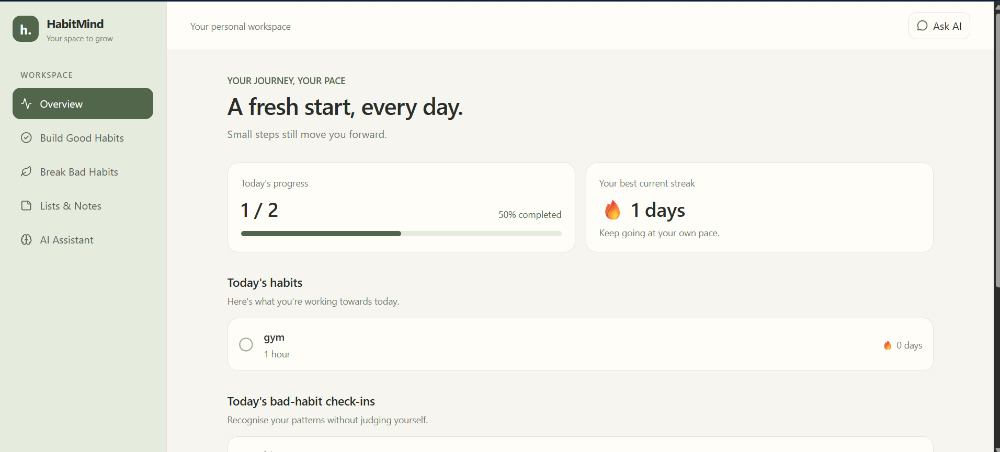
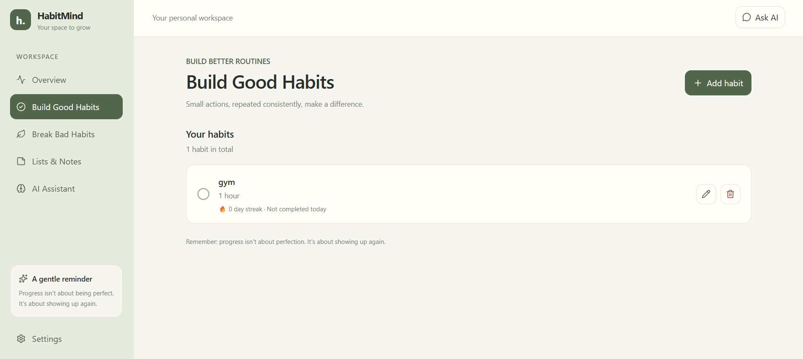
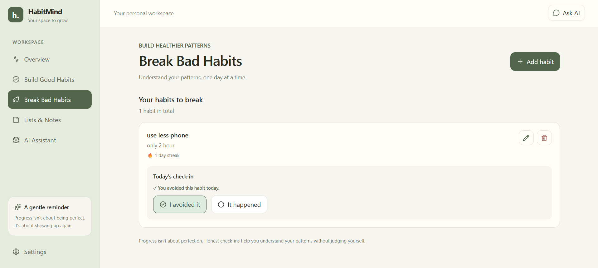
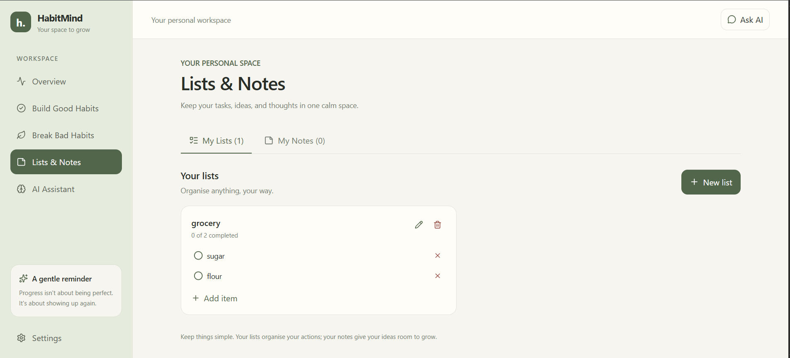

# 🌿 HabitMind

A full-stack personal productivity application that helps users build
good habits, track unwanted habits, organize tasks, and keep notes in
one place through a calm and simple interface.

------------------------------------------------------------------------

## 🚀 Features

-   📊 Overview Dashboard
-   🌱 Create & Track Good Habits
-   🚫 Track Bad Habits with Daily Check-ins
-   🔥 Monitor Habit Streaks
-   📝 Create & Manage Custom Lists
-   ✅ Add, Complete & Delete List Items
-   📒 Create, Edit & Delete Notes
-   🗄 PostgreSQL Database
-   ⚡ FastAPI REST API
-   ⚛ React + TypeScript Frontend
-   🤖 AI Productivity Assistant *(Planned)*

------------------------------------------------------------------------

## 🛠 Tech Stack

### Frontend

-   React
-   TypeScript
-   Vite
-   Tailwind CSS
-   React Router
-   Lucide React

### Backend

-   Python
-   FastAPI
-   SQLAlchemy
-   Pydantic

### Database

-   PostgreSQL

### Development Tools

-   Git & GitHub
-   Visual Studio Code
-   pgAdmin
-   Swagger UI

------------------------------------------------------------------------

## 📊 Habit Tracking & Productivity

The application currently supports:

-   Viewing habit information and progress on the overview dashboard
-   Creating and managing good habits
-   Recording check-ins for unwanted habits
-   Tracking habit streak values
-   Organizing tasks into custom lists
-   Marking list items as completed
-   Creating, editing, and deleting notes
-   Saving lists, list items, and notes persistently in PostgreSQL

------------------------------------------------------------------------

## 📂 Project Structure

``` text
HabitMind
│
├── backend/
│   └── app/
│       ├── database/
│       ├── models/
│       ├── routers/
│       ├── schemas/
│       └── main.py
│
├── frontend/
│   └── src/
│       ├── components/
│       ├── pages/
│       ├── services/
│       └── App.tsx
│
├── screenshots/
│
├── README.md
└── .gitignore
```

------------------------------------------------------------------------

## ⚙ Installation

### Backend

``` bash
cd backend
```

Activate your Python environment and install the dependencies used by
the project.

Create a local `.env` file inside the `backend/` directory and configure
your PostgreSQL connection using `DATABASE_URL`. Make sure the
`habitmind` database exists before starting the server.

Run the backend from the `backend/` directory:

``` bash
python -m uvicorn app.main:app --reload
```

The API will be available at:

http://127.0.0.1:8000

Interactive API documentation:

http://127.0.0.1:8000/docs

### Frontend

``` bash
cd frontend

npm install

npm run dev
```

Open the local URL displayed by Vite in your terminal.

------------------------------------------------------------------------

## 📸 Screenshots

### 🏠 Overview Dashboard



------------------------------------------------------------------------

### 🌱 Build Good Habits



------------------------------------------------------------------------

### 🚫 Break Bad Habits



------------------------------------------------------------------------

### 📝 Lists & Notes



------------------------------------------------------------------------

## 🤖 AI Assistant

The AI Assistant is planned as the next major feature.

Potential future capabilities include:

-   Personalized productivity suggestions
-   Habit pattern analysis
-   Assistance with task organization
-   Summaries of notes and actionable ideas

*AI features are planned and are not implemented yet.*

------------------------------------------------------------------------

## 🔮 Future Improvements

-   AI-powered personal productivity assistant
-   Personalized habit recommendations
-   Behaviour pattern analysis
-   More detailed progress analytics
-   Additional productivity insights
-   Improved validation and error handling

------------------------------------------------------------------------

## 👨‍💻 Author

**Naman Goyal**

------------------------------------------------------------------------

*HabitMind --- Progress, not punishment.*
